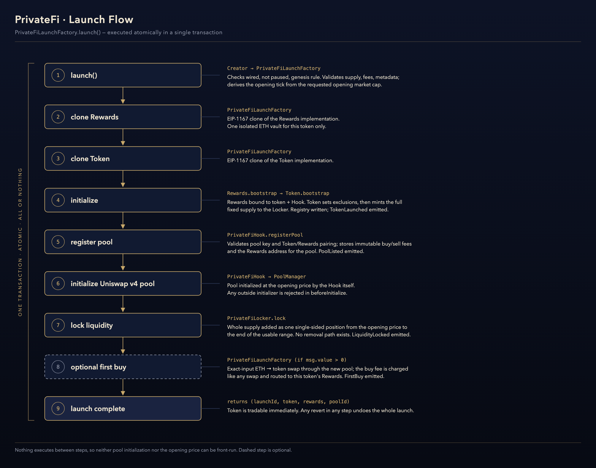

# Architecture


## Topology

```text
User
 ↓
PrivateFiLaunchFactory              (shared · one instance)
 ├─ PrivateFiToken                  (per launch · EIP-1167 clone)
 ├─ PrivateFiRewards                (per launch · EIP-1167 clone)
 ├─ PrivateFiHook                   (shared · one instance · Uniswap v4 hook)
 └─ PrivateFiLocker                 (shared · one instance)
                 ↓
      Uniswap v4 PoolManager        (external · canonical singleton)
```

| Component | Instances | Role |
|---|---|---|
| **PrivateFiLaunchFactory** | 1 | Permissionless entry point. Clones and initializes each launch, keeps the launch registry, and is the only gateway for Claim All and idle recovery. |
| **PrivateFiHook** | 1 | Uniswap v4 hook for every PrivateFi pool. Charges the buy/sell fee in ETH and sends all of it to the pool's own Rewards. |
| **PrivateFiLocker** | 1 | Permanent custodian of every launch's liquidity position. |
| **PrivateFiToken** | 1 per launch | Fixed-supply ERC-20. Its balances are the reward shares. |
| **PrivateFiRewards** | 1 per launch | Isolated ETH vault. Holds only this token's fees and shares them out to its holders. |

### Call graph

```text
Factory → Rewards.bootstrap / Token.bootstrap                (launch)
Factory → Hook.registerPool → PoolManager.initialize         (launch)
Factory → Locker.lock → PoolManager.modifyLiquidity          (launch)
Factory → Rewards.withdrawRewardsFor / Rewards.recoverIdle   (claim, recovery)
Hook    → Rewards.depositFees{value}                         (every swap)
Token   → Rewards.onBalanceShift / onWeightRemoved           (every transfer)
Rewards → Token.rewardWeightOf / eligibleSupply              (view)
Rewards → Hook.factory                                       (view: resolves the trusted Factory)
```

The Token and the Hook never call each other. No contract loops over the set of launches, pools
or holders. Batch operations only loop over a list the caller supplies.

---

## Launch flow



`PrivateFiLaunchFactory.launch(LaunchParams)` runs every step below in one transaction. If any
step reverts, the whole launch reverts.

1. **Validate.** The Factory must be wired and launches must not be paused. The supply must be
   within `[MIN_LAUNCH_SUPPLY, MAX_LAUNCH_SUPPLY]` and fees at most `MAX_FEE_BPS`. Name, symbol
   and metadata URI must be within length limits. The opening tick is derived from the requested
   opening market cap (`openPriceFor`) and must fall within `[MIN_OPEN_TICK, MAX_OPEN_TICK]`.
   The first launch (the genesis launch) can only be made by the Factory owner. Every launch after
   it is permissionless.
2. **Clone Rewards:** an EIP-1167 clone of the Rewards implementation.
3. **Clone Token:** an EIP-1167 clone of the Token implementation.
4. **Initialize.** `Rewards.bootstrap(token, hook)`, then `Token.bootstrap(params)`. The token
   records its reward-exempt protocol addresses, then mints the whole supply to the Locker. The
   Factory writes the registry entry and emits `TokenLaunched`.
5. **Register pool.** `Hook.registerPool` checks the pool key and the Token ↔ Rewards pairing,
   then stores the immutable pool config (buy fee, sell fee, Rewards address). Emits `PoolListed`.
6. **Initialize the Uniswap v4 pool.** The Hook itself calls `PoolManager.initialize` at the
   opening price. Any other initializer is rejected in `beforeInitialize`.
7. **Lock liquidity.** `Locker.lock` adds the whole supply as one single-sided position from the
   opening price to the end of the usable tick range. Emits `LiquidityLocked`.
8. **Optional first buy.** If `msg.value > 0`, the Factory makes an exact-input ETH → token swap
   through the new pool for the creator. The normal buy fee applies. Emits `FirstBuy`.
9. **Complete.** Returns `(launchId, token, rewards, poolId)`.

Because initialization and the opening price are set inside the launch transaction, nobody can
front-run them.

## Trade flow

Every PrivateFi pool is `currency0 = native ETH`, `currency1 = token`, with the dynamic-fee flag
(LP fee fixed at 0), tick spacing `60`, and `hooks = PrivateFiHook`.

| Swap | Direction | Where the fee is taken |
|---|---|---|
| Exact-input buy | ETH → token (`zeroForOne = true`) | `beforeSwap`: deducted from the ETH input |
| Exact-output buy | ETH → token | `afterSwap`: added to the ETH input |
| Exact-input sell | token → ETH (`zeroForOne = false`) | `afterSwap`: deducted from the ETH output |
| Exact-output sell | token → ETH | **Not supported.** Reverts with `ExactOutputSellDisabled` |

The fee is always a percentage of the ETH side of the trade. In the same call, the Hook forwards
it to the pool's Rewards via `depositFees{value: fee}()` and emits `SwapFeeRouted`. The LP fee is
0 and the Hook never changes it, so the Hook fee is the only fee a PrivateFi swap pays. The Token
charges no transfer tax.

## Reward flow

`PrivateFiRewards` uses a cumulative per-share accumulator:

- **Deposit.** `accEthPerWeight += fee × SCALE / eligibleSupply`. This is O(1) no matter how many
  holders there are. Rounding remainders carry into the next deposit, so total entitlements never
  exceed the ETH received.
- **Transfer.** On every mint, burn or transfer, the Token updates `eligibleSupply` and calls
  `Rewards.onBalanceShift(from, to, value)`. Rewards adjusts both accounts so that rewards already
  earned stay with the account that earned them.
- **Excluded addresses.** The Token itself, the dead address, Rewards, the Hook, the PoolManager,
  the Factory and the Locker hold no reward shares. Pool liquidity and infrastructure therefore
  never absorb fees.
- If `eligibleSupply` is below `MIN_ELIGIBLE_SUPPLY` (1 token), deposits are held back and paid
  out in a later distribution.

## Claim flow

Holders claim only through the Factory:

```text
Holder → Factory.claimAll([tokenA, tokenB, …])
          ├→ Rewards(tokenA).withdrawRewardsFor(holder) → ETH → holder
          └→ Rewards(tokenB).withdrawRewardsFor(holder) → ETH → holder
```

- The Factory looks up each token's Rewards in its own registry. A token that was not launched
  reverts the call with `UnknownToken`.
- Each vault pays the holder directly. No function has a recipient parameter, so rewards can only
  go to the account that earned them.
- A vault with nothing owed returns 0 instead of reverting, so one empty vault does not fail the
  batch.
- A claim restarts the holder's 24h idle clock in each vault that paid out.

## Idle recovery

Each account has a `lastActivityAt` timestamp in each Rewards vault:

- It starts when the account first holds reward-bearing tokens.
- It is reset only by a withdrawal or by an idle recovery. Receiving more rewards or tokens does
  **not** reset it.

Once more than `IDLE_WINDOW` (24 hours) has passed, anyone can call
`Factory.recoverIdle(token, accounts)`. For each eligible account, its unclaimed ETH is booked as
withdrawn and moved into that token's `buybackReserve`, and its clock restarts. The accumulator
does not change, so no other holder is affected. No ETH leaves the vault.

The reserve leaves the vault only when the protocol's buyback wallet (fixed at Factory
deployment) calls `claimAll`. The reserve of each listed token is then paid to that wallet.

## Isolation between launches

- Each launch has its own Token and its own Rewards. No balances, accumulators or reserves are
  shared.
- The Hook sends each pool's fee to the `vault` stored in that pool's config, which is written
  once at registration and never changed.
- Each token has exactly one pool (`poolIdOf`) and one locked position (`lockedPoolOf`).
- Rewards accepts `depositFees` only from the Hook and ledger updates only from its own Token.
- One launch can therefore never drain, dilute or redirect another launch's rewards.
