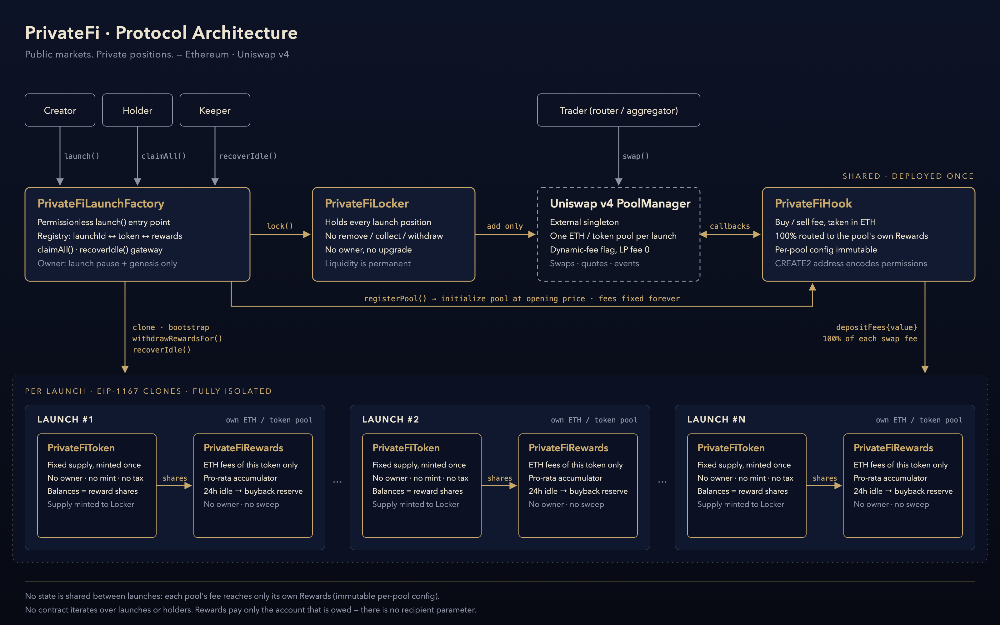

  

<h1 align="center">PrivateFi</h1>

<strong>Public markets. Private positions.</strong>

  <a href="https://privatefi.app">Website</a> ·
  <a href="https://x.com/privatefihooks">X / Twitter</a>

---

PrivateFi is permissionless token launch infrastructure on Ethereum, built on Uniswap v4.

One call to the launch factory creates a fixed-supply token, gives it an isolated ETH rewards
vault, opens its Uniswap v4 pool and locks the whole supply as permanent liquidity. Every buy and
sell on that pool pays a fee in ETH, and 100% of the fee goes to that token's own holders.

This repository is the public technical documentation for the protocol: architecture, contract
roles, security model, integration guide and ABIs. The Solidity source is not published here.

## Core features

| | |
|---|---|
| **Permissionless launches** | Any account can launch a token through `PrivateFiLaunchFactory.launch()`. |
| **Fixed supply** | The full supply is minted once, at launch. There is no mint function afterwards. |
| **Uniswap v4 native** | Each token gets one ETH / token pool on the canonical Uniswap v4 `PoolManager`. |
| **Permanent liquidity** | The whole supply is locked in `PrivateFiLocker`, which has no withdrawal path. |
| **Buy / sell fees in ETH** | Set by the creator at launch (capped at 10%). They can never be changed. |
| **100% fee routing** | Every fee goes to that token's own `PrivateFiRewards`. The platform takes no share. |
| **Holder rewards** | Fees are shared pro-rata across holders, with O(1) accounting. |
| **Claim All** | One transaction claims ETH rewards across any number of tokens. |
| **24h idle recovery** | Rewards left unclaimed for more than 24 hours can be moved to that token's buyback reserve. |
| **Token-specific buyback reserve** | Recovered ETH stays in that token's own vault. |
| **No creator control** | Creators cannot mint, change fees or touch the locked liquidity. |

## Architecture at a glance

- **Shared, deployed once:** `PrivateFiLaunchFactory`, `PrivateFiHook`, `PrivateFiLocker`
- **Per launch (EIP-1167 clones):** `PrivateFiToken`, `PrivateFiRewards`

## About privacy

In PrivateFi, *private* means a private-by-default user experience: positions and rewards are
presented to the owner, and no feature publishes or ranks individual holders. It does **not**
mean anonymous transactions. PrivateFi runs on public Ethereum. Every transaction, balance and
event is visible on-chain and can be linked by anyone who analyses the chain. See
[SECURITY.md](./SECURITY.md#privacy-clarification).

## Documentation

| Document | Contents |
|---|---|
| [ARCHITECTURE.md](./ARCHITECTURE.md) | Contract topology and the launch, trade, reward, claim and idle-recovery flows |
| [CONTRACTS.md](./CONTRACTS.md) | Role, public actions, trusted callers and restrictions for each contract |
| [SECURITY.md](./SECURITY.md) | Security properties, access control, reentrancy, risks and the privacy clarification |
| [DEPLOYMENT.md](./DEPLOYMENT.md) | High-level deployment and wiring order |
| [INTEGRATION.md](./INTEGRATION.md) | Guide for frontend and indexer developers |
| [TESTING.md](./TESTING.md) | Verification checklist |
| [`abi/`](./abi) | Standard ABI JSON for every contract |
| [`diagrams/`](./diagrams) | Architecture and launch-flow diagrams |

## ABIs

| Contract | ABI |
|---|---|
| PrivateFiLaunchFactory | [`abi/PrivateFiLaunchFactory.json`](./abi/PrivateFiLaunchFactory.json) |
| PrivateFiHook | [`abi/PrivateFiHook.json`](./abi/PrivateFiHook.json) |
| PrivateFiLocker | [`abi/PrivateFiLocker.json`](./abi/PrivateFiLocker.json) |
| PrivateFiToken | [`abi/PrivateFiToken.json`](./abi/PrivateFiToken.json) |
| PrivateFiRewards | [`abi/PrivateFiRewards.json`](./abi/PrivateFiRewards.json) |

Each file is a plain ABI JSON array compiled from the production contracts (solc 0.8.26). It contains
no bytecode, source maps, storage layout or compiler metadata.

## Disclaimer

This documentation is for information only. Interacting with smart contracts involves risk,
including total loss of funds. Nothing here is financial advice.
